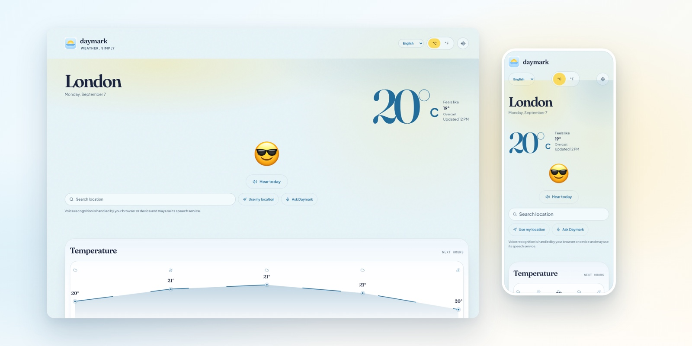
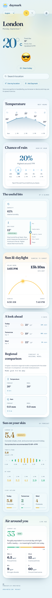
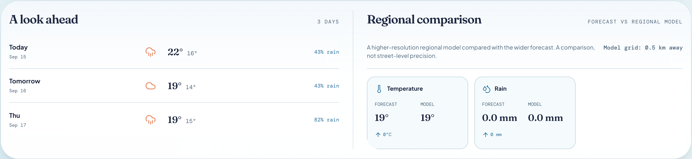
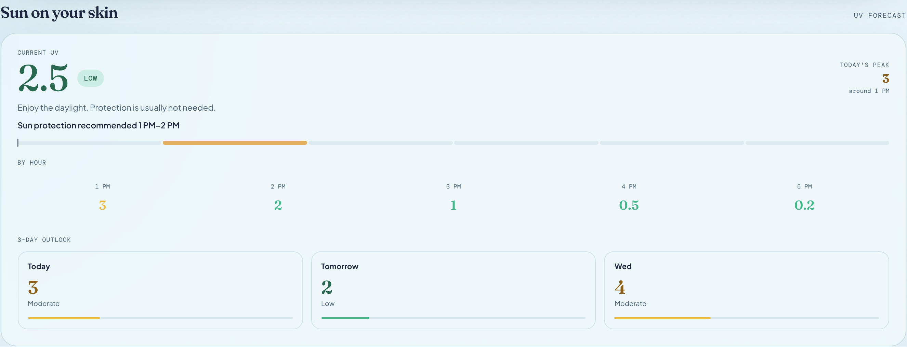
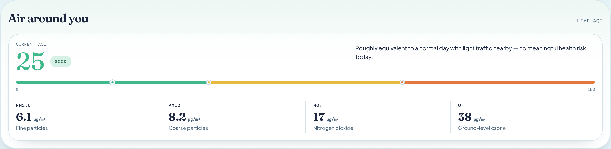

# Daymark

**Weather without the noise.**

A calm, privacy-conscious weather app for the web (PWA) and Android. Current conditions, the next few hours, rain, UV, air quality and daylight — in one readable page, with no account, ads or tracking.

<p>
  <a href="https://github.com/Sami-Gor/daymark/blob/main/LICENSE"></a>
  <a href="https://github.com/Sami-Gor/daymark/commits/main"></a>
  <a href="https://github.com/Sami-Gor/daymark/actions/workflows/ci.yml"></a>
  <a href="https://github.com/Sami-Gor/daymark/actions/workflows/android-ci.yml"></a>
  <a href="https://github.com/Sami-Gor/daymark/actions/workflows/codeql.yml"></a>
</p>

**Live app:** https://daymark-weather.pages.dev · **Source:** https://github.com/Sami-Gor/daymark

[](https://daymark-weather.pages.dev)

## Why Daymark?

- **One question, answered well.** Current conditions, feels-like, a plain-English day cue and the next five hours — without dashboards or clutter.
- **The details that change your day.** Rain chance and rainfall, UV with a protection window, air quality, sunrise and sunset, humidity and dew point.
- **Private by architecture.** No accounts, ads, analytics or telemetry; geolocation is requested only when you tap *Use my location*, and weather and place search go directly to Open-Meteo.
- **Web and Android.** Installable PWA weather demo, plus a Capacitor Android app with the full feature set, on-device Ask Daymark, and offline English narration from the bundled Kokoro voice.

## Overview

Daymark is a client-side app on the web and in the Android WebView, with no Daymark-operated backend or database. It calls Open-Meteo directly for weather and place search; Open-Meteo's own handling is governed by its policies. Device location is only requested when you ask for it.

## Features

- **Current weather** — temperature, feels-like, condition, and a day cue (umbrella / sunglasses / mixed / neutral) in the hero
- **Temperature** — a compact five-hour trend with the peak marked; **Chance of rain** — a peak-first droplet timeline for the next five hours
- **3-day forecast** — highs, lows, and precipitation per day
- **Sun on your skin** — current UV index with a protection range gauge, hourly UV strip, and a 3-day outlook
- **Sun & daylight** — sunrise, solar noon, sunset and daylight length with a sun-path arc
- **Air around you** — live US AQI with WHO/city comparison markers, pollutant breakdown (PM2.5, PM10, NO₂, O₃), and plain-English context
- **A look ahead + Regional comparison** — the 3-day outlook and a higher-resolution regional model compared against the wider forecast; hidden where that model is not valid
- **Dew point & comfort** — alongside humidity, because dew point is what your skin actually feels
- **Location search** — switch to any city or town using Open-Meteo geocoding, with region/country disambiguation
- **Severe weather risk** — forecast-derived wind, rain, snow, thunderstorm, heat and cold risks, clearly labelled as *not* official warnings
- **Voice (Android only)** — the web/PWA demo has no Ask Daymark or Hear today controls and does not use browser speech APIs. On Android, English *Hear today* uses the bundled local Kokoro voice, and *Ask Daymark* uses the bundled Parakeet TDT 0.6B v3 model through sherpa-onnx on the device. French and Spanish narration is not available in V2 (planned for V2.2); no Android system-TTS or network fallback is used.
- **English, French and Spanish** — locale-aware UI, guidance, and alerts, with Android English voice features, defaulting to the browser language
- **°C / °F toggle**, graceful offline shell, and installable as an app (PWA)

## Interface

The design is editorial rather than dashboard-like — a serif-led hero with a plain-English day cue, matched forecast cards, and compact feature sections that each keep their own personality.

**Responsive, mobile-first** — the full page at 390px:

<details>
<summary><strong>View the full mobile page</strong></summary>

<p align="center"></p>

</details>

**A look ahead + Regional comparison** — the 3-day outlook beside the higher-resolution regional model:



**Sun on your skin** — current UV with advice, today's peak, the next five hours, and a 3-day outlook:



**Air around you** — live AQI with plain-English context and pollutant readings:



## Tech stack

- [React 19](https://react.dev) + [TypeScript](https://www.typescriptlang.org) + [Vite 7](https://vite.dev)
- [Capacitor 8](https://capacitorjs.com) for the Android shell; weather and place search use [Open-Meteo](https://open-meteo.com)
- [Tailwind CSS 4](https://tailwindcss.com) with a hand-written design layer (Fraunces, Plus Jakarta Sans, DM Mono — self-hosted)
- [Zod](https://zod.dev) for runtime validation of every API response
- [wouter](https://github.com/molefrog/wouter) for routing and [Radix](https://www.radix-ui.com) primitives
- Typed English/French/Spanish dictionaries (no i18n dependency); Android uses native Kokoro for English narration and native Parakeet for speech input. French/Spanish narration is explicitly unavailable in V2.
- pnpm workspaces; Vitest + Playwright for tests

## Architecture

Daymark is a **client-side single-page app + PWA**. There is:

- **No backend, no database, no server code** — the repository ships static files only
- **No user accounts, no ads, no in-app analytics or telemetry, no cookies**
- One workspace package that matters: `artifacts/weather-app` (plus `artifacts/mockup-sandbox`, a local-only design tool that is never deployed)

All weather logic lives in [`artifacts/weather-app/src/lib/weather.ts`](artifacts/weather-app/src/lib/weather.ts): typed Open-Meteo clients, permissive-but-strict Zod schemas at the network boundary, 10-second fetch timeouts, and the formatting/categorisation helpers. Building on that: `weather-alerts.ts` is a pure forecast-risk engine, `weather-intents.ts` is a language-independent intent/response layer shared by Android voice, `i18n.ts` + `locales/` hold the typed translations, `speech-router.ts` / `speech-engine.ts` contain the Android narration routing, and `voice-input-native.ts` is the Parakeet recognition adapter. UI components live in `src/components/weather/`.

## Privacy approach

The bullets below describe the **released v1.0.0** build, which is what the
shipped Google Play release and the deployed website run. The
`release/v2-candidate` branch changes the location and voice behaviour;
those changes are called out inline and documented in full in
[docs/release/version-2-privacy-hardening.md](docs/release/version-2-privacy-hardening.md).
The v2 branch is not released.

- **Geolocation is never requested on load.** The app opens on a default location (London) and only touches the Geolocation API when you press *Use my location*
- **Device coordinates are rounded to a latitude-aware grid on the device before leaving it**, with a 0.025° minimum latitude step; longitude widens only where needed to keep the represented area at least 3 km². Coordinates are sent only to Open-Meteo endpoints. The installed Android app also requests approximate location only (`ACCESS_COARSE_LOCATION`; `ACCESS_FINE_LOCATION` is not declared); the web/PWA and Android paths use the same policy.
- **No user history is persisted by Daymark** — the language preference (`daymark.locale`) is stored in web localStorage. The Android voice module stores a private `microphone-requested` boolean in SharedPreferences named `daymark.permissions` only to avoid repeatedly prompting for microphone permission after it has already been requested or denied. The web/PWA service worker caches app-shell files; app code separately caches the locality dataset in Cache Storage. The Android app loads its locality dataset from bundled assets. Neither setting is location history, search history, a transcript, or a weather response.
- **Public privacy policy** — a full policy is part of the app at `/privacy` (English), `/fr/privacy` (French) and `/es/privacy` (Spanish); the footer links to the version matching the interface language. It documents the actual data flows, local-storage behavior and third-party services described above
- **No analytics or third-party trackers** — weather and location-search requests go to Open-Meteo. The web/PWA demo has no voice features. Android voice input is on-device via the bundled Parakeet model, and English narration is local Kokoro; French/Spanish narration is unavailable in V2 and never falls back to system TTS or a network voice. Daymark does not intentionally store audio, transcripts, or narration text. The model is a large download delivered by Google Play.
- Fonts are self-hosted; no CDN font requests

## Weather data source

Live forecasts, air-quality data and place-search suggestions come from [Open-Meteo](https://open-meteo.com) — free for non-commercial use, no API key required. Device-location locality labels are resolved locally from GeoNames: the web/PWA downloads and caches the dataset for offline lookup, while Android includes it in bundled assets. Weather and air-quality responses are not cached by the app or service worker.

## PWA / offline behavior

Daymark installs as a standalone app (manifest + icons included). A minimal service worker caches the **app shell only** — HTML, hashed JS/CSS, fonts, and icons — so the app opens offline. Live weather always comes from the network: Open-Meteo responses are never cached, and a cold network shows a friendly error with retry rather than stale data. Updates follow network-first navigation with a versioned cache, so users are never trapped on an old build.

## Local development

Requires [Node](https://nodejs.org) and [pnpm](https://pnpm.io). **Node 24 is the CI-tested runtime**; Node 20+ generally works.

```bash
pnpm install          # frozen lockfile enforced
pnpm --filter @workspace/weather-app run dev     # http://localhost:5173
```

Replit injects `PORT`/`BASE_PATH` in workspaces; locally they default sensibly (`5173`, `/`).

## Build

```bash
pnpm run build        # typecheck + build all packages
```

Output lands in `artifacts/weather-app/dist/public` — deploy it to any static host. `public/_headers` ships a production security-header set (CSP, HSTS, etc.) for hosts that honour it (Cloudflare Pages, Netlify); configure the same headers manually on hosts that don't.

## Android app (Capacitor shell)

The Android build wraps the same web bundle in a Capacitor shell
(`artifacts/weather-app/android`) with a native `DaymarkVoice` plugin: the
bundled Kokoro model and `bm_fable` voice run fully on-device (streaming
AudioTrack) for English narration. Android Ask Daymark uses the bundled
Parakeet model on-device. French/Spanish narration is unavailable in V2; the
browser demo has no voice path. The legacy TWA project is preserved at
`android/` as the rollback point.

```bash
# One-time native prerequisites. Their outputs are gitignored, so a fresh clone
# does not contain them: see android/kokoro-poc/README.md for the toolchain.
#   Rust 1.98.1 with the aarch64-linux-android target, Android NDK 29.0.14206865
android/kokoro-poc/scripts/fetch-kokoro-assets.sh    # Kokoro model + bm_fable voice
ANDROID_NDK_HOME=$ANDROID_NDK_HOME \
  android/kokoro-poc/scripts/build-kokoro-android.sh  # libkokoro_jni.so (arm64-v8a)

cd artifacts/weather-app
pnpm exec cap sync android
pnpm run verify:android-web-assets
cd android
# macOS example; on other systems set JAVA_HOME to your installed JDK 21 path.
JAVA_HOME=$(/usr/libexec/java_home -v 21) ./gradlew :app:assembleRelease :app:bundleRelease
```

A signed release build additionally needs `artifacts/weather-app/android/keystore.properties`,
which is gitignored and must never be committed. Without the two Kokoro steps the
app still builds, but English narration is unavailable at runtime.

Release: package `io.github.sami_gor.daymark` (released v1.0.0: versionCode 1 / versionName 1.0.0; V2 candidate on this branch: versionCode 2 / versionName 2.0.0). See [docs/architecture/capacitor-migration.md](docs/architecture/capacitor-migration.md) for the architecture, plugin API and lifecycle details, and [docs/release/play-console-checklist.md](docs/release/play-console-checklist.md) for the Play release chain.

## Test

```bash
pnpm --filter @workspace/weather-app run test         # Vitest unit suite (347 tests on the current V2 candidate)
pnpm --filter @workspace/weather-app run test:e2e     # Playwright browser suite (141 tests on the current V2 candidate)
```

The e2e suite runs against a production build served by `vite preview`, mocks Open-Meteo traffic, and covers function, responsive widths (320–1440), axe-core accessibility, geolocation privacy (including wire-level coordinate rounding), failure paths, the service worker, the served security headers, location search, the web/PWA no-voice boundary, severe-weather alerts and the English/French/Spanish interface.

## Security

See [SECURITY.md](SECURITY.md) for the web/PWA and Android posture, and [the weather-app security and privacy research](docs/security/README.md) for documented incidents, source links, and the controls they inform. In short: minimal attack surface (12 runtime dependencies), API responses runtime-validated at the network boundary, a strict CSP for the hosted web/PWA (`default-src 'none'`, `script-src 'self'`), Android English narration generated on-device by the bundled Kokoro engine, and no secrets in the client. The installed Android WebView does not inherit the hosted site's HTTP security headers.

## Project structure

```
artifacts/
  weather-app/            production React/Vite app (SPA + PWA)
    public/               manifest, service worker, icons, _headers
    src/lib/weather.ts    API boundary + Zod schemas + location-safe time helpers
    src/lib/weather-alerts.ts   forecast-derived risk engine (not official warnings)
    src/lib/weather-intents.ts  stable intent IDs + response layer (voice/agents)
    src/lib/speech-*.ts   Android narration routing and UI state
    src/lib/voice-input-native.ts  Android Parakeet recognition adapter
    src/lib/i18n.ts
    src/locales/          EN / FR / ES typed dictionaries
    src/hooks/            locale, Android narration and recognition bindings
    src/components/       UI components
    src/fonts/            self-hosted fonts + licences
    tests/e2e/            Playwright suite
    android/              production Capacitor Android shell
      app/                Capacitor application module
      daymark-voice/      native DaymarkVoice plugin (Kokoro narration, Parakeet input)
  mockup-sandbox/         local design sandbox (never deployed)
android/                  frozen TWA/Bubblewrap rollback project (see android/README.md)
  kokoro-poc/             shared Kokoro Rust/JNI source + fetch/build scripts
docs/                     architecture, release audit, README screenshots
scripts/                  workspace tooling
```

## Documentation

- [Architecture and the Capacitor migration](docs/architecture/capacitor-migration.md)
- [Security posture](SECURITY.md) and [security research](docs/security/README.md)
- [Android production readiness](docs/release/android-production-readiness.md) and the [Play release checklist](docs/release/play-console-checklist.md)
- [Privacy policy](https://daymark-weather.pages.dev/privacy), also available in the app at `/privacy`, `/fr/privacy` and `/es/privacy`

## What's Coming

**v2.0 — Coming soon**

The next evolution of Daymark is in its final stages. Release details to follow.

**v3.0 — On the horizon**

Further ideas are in exploration as Daymark continues to evolve.

## Known limitations

- Unit preference (°C/°F) is not persisted across reloads (the language preference is)
- The regional comparison uses the UKV model and is hidden where that model is not valid
- Severe-weather risks are forecast-derived Daymark estimates, **not** official warnings
- The web/PWA is a limited weather demo: it has no Ask Daymark or Hear today controls and does not invoke browser speech-recognition or speech-synthesis APIs.
- On Android, English narration uses the bundled offline Kokoro voice. French and Spanish narration is not available in V2 and is planned for V2.2; the app shows an unavailable message and does not use Android system TTS or a network voice.
- Android Ask Daymark uses the bundled Parakeet TDT 0.6B v3 int8 model through sherpa-onnx on supported Android 10+ versions (minSdk 29); the code path uses no platform recogniser or online fallback. This is source/test evidence, not a packet-level zero-egress guarantee.
- The Android shell currently bundles the arm64-v8a Kokoro library only
- Air-quality "nearby sensor" comparison is not yet wired to a sensor network; the regional forecast is shown
- The very first reload immediately after a service-worker update may briefly miss the offline shell (self-heals on the next reload)

## License

Daymark's source is [MIT](LICENSE). Bundled third-party components keep their own upstream licences and are **not** relicensed by MIT: the self-hosted fonts (SIL OFL 1.1, see [`artifacts/weather-app/src/fonts/LICENSE.md`](artifacts/weather-app/src/fonts/LICENSE.md)); the Kokoro runtime, model and `bm_fable` voice assets (see the licensing matrix in [`android/kokoro-poc/README.md`](android/kokoro-poc/README.md)); other native components retain the licences listed in that matrix. The bundled locality dataset is [GeoNames](https://www.geonames.org/) data under CC BY 4.0, credited in the in-app privacy policy. Weather data by [Open-Meteo](https://open-meteo.com) (CC BY 4.0 attribution requested for non-commercial use).

## Contributing

Issues and pull requests are welcome.

- Keep the client-only architecture: no backend, no tracking, and no new third-party network origins without discussion.
- Read [SECURITY.md](SECURITY.md) before changing network, location, voice or storage behaviour, and report security issues privately as described there.
- Follow the existing typed API boundary and Zod validation in [`artifacts/weather-app/src/lib/weather.ts`](artifacts/weather-app/src/lib/weather.ts); the security posture is documented in [`docs/security/daymark-security.md`](docs/security/daymark-security.md).
- Run the same checks as CI before opening a PR:

  ```bash
  pnpm --filter @workspace/weather-app run typecheck
  pnpm --filter @workspace/weather-app run test
  pnpm --filter @workspace/weather-app run test:e2e
  ```

  Android changes also run through [`.github/workflows/android-ci.yml`](.github/workflows/android-ci.yml).
