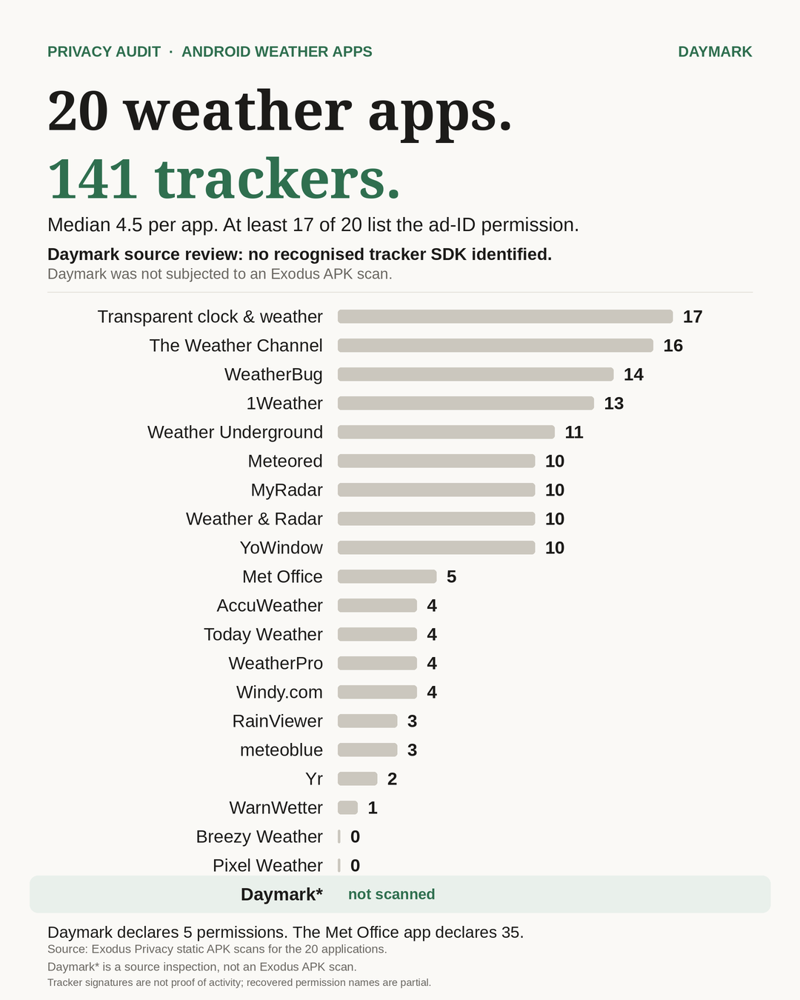

# Android Weather Apps: Tracker and Permission Audit

**A static analysis of 20 Android weather applications, compared with Daymark.**

Prepared 2026-11-04 · Dataset: [`research/tracker-audit/raw.json`](../../research/tracker-audit/raw.json) · Share card: [`research/tracker-audit/audit-card.png`](../../research/tracker-audit/audit-card.png)

---

## Summary

Twenty Android weather applications were scanned with [Exodus Privacy](https://reports.exodus-privacy.eu.org)'s static APK analysis. Between them they carry **141 tracker detections** — code signatures for advertising, analytics, crash-reporting and profiling SDKs found inside the APK. The median application carries **4.5**; the worst carries **17**.

**At least 17 of the 20** applications explicitly list `ACCESS_ADSERVICES_AD_ID` in the permission names recovered from their Exodus reports. The available permission names do not establish whether the remaining three also declare it. **18 of 20** carry at least one detected tracker signature.

Daymark is included as a reference row rather than a scanned subject. No recognised advertising, analytics, crash-reporting or attribution SDK was identified in Daymark's manifest and 12 declared JavaScript runtime dependencies by source inspection. Daymark was not subjected to an Exodus APK scan. Its manifest declares **no advertising-ID permission** and **five permissions**.

### Quotation-ready

> An Exodus Privacy static analysis of 20 Android weather applications identified 141 aggregate tracker detections, with a median of 4.5 per application. At least 17 of the 20 applications explicitly list `ACCESS_ADSERVICES_AD_ID` in the permission names recovered from their Exodus reports. The available permission names do not establish whether the remaining three also declare it. No recognised advertising, analytics, crash-reporting or attribution SDK was identified in Daymark's manifest and 12 declared JavaScript runtime dependencies by source inspection. Daymark was not subjected to an Exodus APK scan.

These findings describe the **specific APK versions listed below**, as recorded in the Exodus Privacy reports at the stated dates. They are not a statement about every version of these applications, past or future.



*Share card — regenerate with `make_card.py`; the figures come from `raw.json`, not from hand-edited pixels.*

## Headline figures

| Measure | Result |
|---|---:|
| Applications scanned | 20 |
| Tracker detections (sum of per-app counts) | **141** |
| Median trackers per application | **4.5** |
| Mean trackers per application | 7.05 |
| Highest count | 17 (Transparent clock & weather) |
| Lowest count | 0 (Breezy Weather, Pixel Weather) |
| Applications with ≥1 detection | 18 of 20 |
| Distinct tracker identities across the sample | 46 |
| Applications whose recovered Exodus permission names list `ACCESS_ADSERVICES_AD_ID` | At least 17 of 20 |
| Applications declaring background location | 19 of 20 |
| Recognised SDKs identified in Daymark source inspection | 0 |
| Daymark declared permissions | 5 |
| Met Office declared permissions | 35 |

The median is the mean of the 10th and 11th values of the ascending counts (4 and 5), i.e. 4.5. A "tracker detection" is one distinct tracker identity attributed to one application; the same SDK found in ten apps counts ten times, and one app using two SDKs from the same company counts twice. This is **not** a count of tracker companies and **not** a count of tracker executions.

## Method

### Selection

The 20 applications were chosen by hand from Play Store search results and F-Droid, spanning market leaders, public-sector broadcasters (Met Office, Yr, WarnWetter) and open-source controls (Breezy Weather, Google's Pixel Weather). The sample is **not random and not install-weighted**: it approximates what a person browsing the Play Store would plausibly install as a weather app.

Two candidates, BBC Weather and CARROT, were excluded because the newest Exodus report available for each was from 2022–2023 and no longer represented the shipped app. They were excluded for staleness, not because they scanned clean.

### What a tracker detection means

Exodus Privacy performs **static analysis** of the APK: it inspects the package contents and matches known tracker SDK signatures. A "detection" is the presence of a signature in the APK, not evidence that the SDK initialised, ran, or transmitted anything.

### Aggregation

For each application the dataset records the count of distinct tracker identities reported by Exodus. The aggregate of 141 is the arithmetic sum of those 20 per-application counts. The median is computed over the 20 per-application counts. The mean (7.05) is reported for completeness; it is not used in any headline claim.

### Declared permissions

Permission counts are the totals Exodus reports for each scanned APK — every permission declared in the merged manifest, including those contributed by libraries. They are **declarations, not usage**. A count says nothing about whether a permission is requested at runtime, granted, or exercised.

Only a subset of each application's permission names could be recovered from the report page (see [Coverage gaps](#coverage-gaps)); the counts and the names should not be treated as the same thing.

### Advertising-ID classification

This audit counts an application as explicitly listing advertising-ID access when the recovered Exodus permission names include `ACCESS_ADSERVICES_AD_ID` — the Android 13+ advertising-ID permission. At least 17 applications explicitly list it. The available permission names do not establish whether the remaining three also declare it. Among the recovered names, none of the 17 explicitly listing the newer permission also lists the older `com.google.android.gms.permission.AD_ID`. A permission declaration indicates access is allowed; it does not establish that the app actually reads the advertising ID.

### Daymark

Daymark is **not** an Exodus scan. Its row is derived from source inspection of the Android manifest and declared JavaScript runtime dependencies in the Daymark source repository. No recognised advertising, analytics, crash-reporting or attribution SDK was identified in Daymark's manifest and 12 declared JavaScript runtime dependencies by source inspection. Daymark was not subjected to an Exodus APK scan.

The manifest declares five permissions — `INTERNET`, `ACCESS_COARSE_LOCATION`, `ACCESS_FINE_LOCATION`, `RECORD_AUDIO`, `MODIFY_AUDIO_SETTINGS` — and contains no advertising-ID or background-location permission. The source-inspection result is not an Exodus tracker count.

### Snapshot

Reports were fetched 3–4 November 2026 from the "latest report" page for each package. The per-application scan dates in the table are the dates Exodus created those reports; most fall between late August and October 2026, with one older report (WarnWetter, 30 March 2026). The dataset is the snapshot, not a live feed: Exodus may publish newer reports at any time.

## Application-level results

Sorted by tracker detections, descending, then by application name. This matches the source dataset's order.

| Application | Package | Version | Report date | Trackers | Ad ID evidence | Permissions | Bg location | Exodus report |
|---|---|---|---:|---:|---|---:|---|---|
| Transparent clock & weather | `com.droid27.transparentclockweather` | 9.17.0 | Oct. 6, 2026, 6:29 p.m. | 17 | listed | 27 | yes | [report](https://reports.exodus-privacy.eu.org/en/reports/com.droid27.transparentclockweather/latest/) |
| The Weather Channel | `com.weather.Weather` | 16.21.1 | Sept. 11, 2026, 3:12 a.m. | 16 | listed | 22 | yes | [report](https://reports.exodus-privacy.eu.org/en/reports/com.weather.Weather/latest/) |
| WeatherBug | `com.aws.android` | 6.7.0 | Sept. 3, 2026, 7:04 p.m. | 14 | listed | 28 | yes | [report](https://reports.exodus-privacy.eu.org/en/reports/com.aws.android/latest/) |
| 1Weather | `com.handmark.expressweather` | 12.9.3 | Sept. 19, 2026, 1:29 a.m. | 13 | listed | 25 | yes | [report](https://reports.exodus-privacy.eu.org/en/reports/com.handmark.expressweather/latest/) |
| Wunderground | `com.wunderground.android.weather` | 6.20.1 | Aug. 29, 2026, 4:57 p.m. | 11 | listed | 18 | yes | [report](https://reports.exodus-privacy.eu.org/en/reports/com.wunderground.android.weather/latest/) |
| Meteored | `aplicacion.tiempo` | 8.12.8_free | Oct. 31, 2026, 12:52 p.m. | 10 | listed | 27 | yes | [report](https://reports.exodus-privacy.eu.org/en/reports/aplicacion.tiempo/latest/) |
| MyRadar | `com.acmeaom.android.myradar` | 8.73.0 | Aug. 29, 2026, 9:21 p.m. | 10 | listed | 29 | yes | [report](https://reports.exodus-privacy.eu.org/en/reports/com.acmeaom.android.myradar/latest/) |
| Weather&Radar | `de.wetteronline.wetterapp` | 2026.20 | Oct. 16, 2026, 5:58 a.m. | 10 | listed | 32 | yes | [report](https://reports.exodus-privacy.eu.org/en/reports/de.wetteronline.wetterapp/latest/) |
| YoWindow | `yo.app.free` | 2.59.18 | Aug. 25, 2026, 11:12 a.m. | 10 | listed | 30 | yes | [report](https://reports.exodus-privacy.eu.org/en/reports/yo.app.free/latest/) |
| Met Office | `uk.gov.metoffice.weather.android` | 3.69.0 | Oct. 28, 2026, 6:26 a.m. | 5 | listed | 35 | yes | [report](https://reports.exodus-privacy.eu.org/en/reports/uk.gov.metoffice.weather.android/latest/) |
| AccuWeather | `com.accuweather.android` | 21.2.0 | Oct. 16, 2026, 5:29 p.m. | 4 | listed | 21 | yes | [report](https://reports.exodus-privacy.eu.org/en/reports/com.accuweather.android/latest/) |
| Today Weather | `mobi.lockdown.weather` | 2.5.1 | Sept. 3, 2026, 7:01 p.m. | 4 | listed | 22 | yes | [report](https://reports.exodus-privacy.eu.org/en/reports/mobi.lockdown.weather/latest/) |
| WeatherPro | `com.mg.android` | 5.6.13 | Oct. 6, 2026, 6:32 p.m. | 4 | listed | 26 | yes | [report](https://reports.exodus-privacy.eu.org/en/reports/com.mg.android/latest/) |
| Windy.com | `com.windyty.android` | 51.3.2 | Oct. 19, 2026, 5:30 p.m. | 4 | listed | 27 | yes | [report](https://reports.exodus-privacy.eu.org/en/reports/com.windyty.android/latest/) |
| RainViewer | `com.lucky_apps.RainViewer` | 7.21 | Sept. 14, 2026, 11:36 a.m. | 3 | listed | 25 | yes | [report](https://reports.exodus-privacy.eu.org/en/reports/com.lucky_apps.RainViewer/latest/) |
| meteoblue | `com.meteoblue.droid` | Cirrus Uncinus 3.1.6 | Oct. 25, 2026, 9:14 p.m. | 3 | listed | 18 | no | [report](https://reports.exodus-privacy.eu.org/en/reports/com.meteoblue.droid/latest/) |
| Yr | `no.nrk.yr` | 6.7.0 | Oct. 20, 2026, 9:15 a.m. | 2 | listed | 21 | yes | [report](https://reports.exodus-privacy.eu.org/en/reports/no.nrk.yr/latest/) |
| WarnWetter | `de.dwd.warnapp` | 5.4.2 | March 30, 2026, 11:47 a.m. | 1 | not listed | 17 | yes | [report](https://reports.exodus-privacy.eu.org/en/reports/de.dwd.warnapp/latest/) |
| Breezy Weather | `org.breezyweather` | 6.2.2_freenet | Aug. 26, 2026, 10:42 p.m. | 0 | not listed | 18 | yes | [report](https://reports.exodus-privacy.eu.org/en/reports/org.breezyweather/latest/) |
| Pixel Weather | `com.google.android.apps.weather` | 1.1.20260716.979549101.release | Sept. 26, 2026, 6:11 p.m. | 0 | not listed | 21 | yes | [report](https://reports.exodus-privacy.eu.org/en/reports/com.google.android.apps.weather/latest/) |
| **Daymark** | `io.github.sami_gor.daymark` | not scanned | — | **0*** | absent (manifest) | **5** | **no** | [manifest](https://github.com/Sami-Gor/daymark/blob/main/artifacts/weather-app/android/app/src/main/AndroidManifest.xml) |

The Daymark row is separated because it comes from a different method: manifest and dependency inspection, not an Exodus scan of a published APK. Its `0*` tracker value means no recognised SDK was identified by that source inspection; it is not an Exodus result. For the 20 scanned applications, `listed` means the permission name appears in the recovered Exodus list and `not listed` means only that it was absent from the names available in the report extract. The Daymark `absent (manifest)` entry is based on its own manifest.

### Fields not recorded

The following were **not** captured in the original dataset and are deliberately left out rather than reconstructed:

- developer/publisher names;
- Android `versionCode` values (only the version name string was recorded);
- APK SHA-256 hashes;
- the exact APK build/flavour scanned by Exodus.

Adding them would require re-scanning or re-fetching, which would produce a different snapshot. See [Coverage gaps](#coverage-gaps).

## Permission comparison

| Application | Declared permissions |
|---|---:|
| Daymark | 5 |
| Met Office | 35 |

Daymark's five, from its manifest: `INTERNET`, `ACCESS_COARSE_LOCATION`, `ACCESS_FINE_LOCATION`, `RECORD_AUDIO`, `MODIFY_AUDIO_SETTINGS`. Location is requested only when the user taps the location control; the app has no background-location permission.

The Met Office application's 35 declared permissions include the following 15 names recoverable from its Exodus report:

- `ACCESS_ADSERVICES_AD_ID`
- `ACCESS_ADSERVICES_ATTRIBUTION`
- `ACCESS_ADSERVICES_TOPICS`
- `ACCESS_BACKGROUND_LOCATION`
- `ACCESS_COARSE_LOCATION`
- `ACCESS_FINE_LOCATION`
- `ACCESS_NETWORK_STATE`
- `ACCESS_WIFI_STATE`
- `AD_SERVICES_CONFIG`
- `FOREGROUND_SERVICE`
- `INTERNET`
- `POST_NOTIFICATIONS`
- `READ_APP_BADGE`
- `RECEIVE_BOOT_COMPLETED`
- `WAKE_LOCK`

The remaining 20 are counted by Exodus but were not named in the extractable page content, so they are not listed here.

**A permission count is not a privacy score.** A weather app needs location and network access to work; an app with many permissions may use none of them, and an app with few may still transmit data through the ones it has. The comparison is included because the contrast is stark and factual, not because counting permissions settles anything.

## What this does not prove

- **A detected tracker signature does not establish that the tracker executed.** Exodus finds code in the APK. It cannot show whether the SDK initialised, what it sent, or where it sent it.
- **A source inspection finding no recognised SDK does not prove an application never transmits data.** Daymark's forecast requests necessarily reach Open-Meteo, which sees the request and an approximate location. This audit did not scan a Daymark APK.
- **Declared permissions do not prove those permissions were exercised.** Nineteen of the twenty apps declare background location, including an open-source one; declaration is what the manifest says, not what the app does.
- **Findings apply to the tested APK versions and this scan snapshot.** Versions change; a newer build may add or remove SDKs, and Exodus reports are periodically regenerated.
- **This is a comparative technical snapshot, not a privacy or security certification.** It does not assess server-side collection, encryption, retention, account handling, or vulnerabilities.

Server-side collection is invisible to this method: IP addresses, API logs and account data never appear in a static scan. Daymark shares that residual exposure — Open-Meteo sees the user's IP and a location rounded to roughly 1 km before transmission.

## Coverage gaps

Recorded honestly rather than papered over:

1. **No APK hashes or version codes.** The original scrape captured version names and report dates only. The reports are therefore identified by package, version string and date.
2. **Permission names are partial.** Each app's declared count exceeds the number of names exposed on the report page (total declared 17–35, named 12–22). Counts are reliable; the named lists are illustrative, not exhaustive.
3. **Advertising-ID evidence rests on the recovered names.** At least 17 reports explicitly list `ACCESS_ADSERVICES_AD_ID`. For WarnWetter, Breezy Weather and Pixel Weather it was not listed in the permission names exposed by the report page; a full manifest dump was not retained, so their absence is not established.
4. **One stale report.** WarnWetter's report dates from 30 March 2026, roughly seven months older than the rest of the sample.
5. **Daymark was not scanned.** Its row is a source inspection, and it is labelled as such throughout.

## Reproducing this audit

The dataset, generator and validation script live in [`research/tracker-audit/`](../../research/tracker-audit/):

```bash
cd research/tracker-audit
python3 validate.py          # recompute every headline metric from raw.json
python3 make_card.py         # regenerate audit-card.png (1080x1350)
```

`validate.py` reads `raw.json` and the Daymark manifest and fails if any published figure no longer matches. `make_card.py` regenerates the share card from the same file, so the image cannot drift from the data.

To extend the sample, add packages to `scrape_exodus.py` and re-run it; that produces a **new** snapshot and the headline figures must be recomputed, not assumed.

## Dataset and provenance

- Raw results: [`research/tracker-audit/raw.json`](../../research/tracker-audit/raw.json) — one object per application, including the full tracker list with Exodus category tags.
- Sources and per-application links: [`research/tracker-audit/SOURCES.md`](../../research/tracker-audit/SOURCES.md).
- Card generator: [`research/tracker-audit/make_card.py`](../../research/tracker-audit/make_card.py).
- Scraper used for the original collection: `scrape_exodus.py` (authoring copy, not committed; the method is described in `SOURCES.md`).

### Tracker identities by application

| Application | Count | Detected tracker identities |
|---|---:|---|
| Transparent clock & weather | 17 | Amazon Advertisement, AppLovin (MAX and SparkLabs), AppMetrica, AppMonet, Facebook Ads, Fyber, Google AdMob, Google CrashLytics, Google Firebase Analytics, IAB Open Measurement, ironSource, Mintegral, myTarget, myTracker, Pangle, Singular, Yandex Ad |
| The Weather Channel | 16 | Amazon Advertisement, Amplitude, AppLovin (MAX and SparkLabs), AppsFlyer, ComScore, Facebook Ads, Google AdMob, Google CrashLytics, Google Firebase Analytics, IAB Open Measurement, Inmobi, MoEngage, mParticle, New Relic, Prebid Mobile, Taboola |
| WeatherBug | 14 | Amazon Advertisement, AppLovin (MAX and SparkLabs), AppNexus, Appodeal Stack, BidMachine, Facebook Flipper, Google AdMob, Google CrashLytics, Google Firebase Analytics, IAB Open Measurement, ironSource, JW Player, Prebid Mobile, Taboola |
| 1Weather | 13 | Amazon Advertisement, Amazon Mobile Analytics (Amplify), AppLovin (MAX and SparkLabs), AppsFlyer, Facebook Ads, Fyber, Google AdMob, Google CrashLytics, Google Firebase Analytics, IAB Open Measurement, Inmobi, MoEngage, Taboola |
| Wunderground | 11 | Amazon Advertisement, AppsFlyer, Flurry, Google AdMob, Google CrashLytics, Google Firebase Analytics, IAB Open Measurement, Mapbox, Moat, mParticle, Twitter MoPub |
| Meteored | 10 | Adjust, Amazon Advertisement, ComScore, Facebook Ads, Facebook Analytics, Google AdMob, Google CrashLytics, Google Firebase Analytics, IAB Open Measurement, Pangle |
| MyRadar | 10 | AppLovin (MAX and SparkLabs), AppsFlyer, Cuebiq, Google AdMob, Google CrashLytics, Google Firebase Analytics, IAB Open Measurement, Inmobi, OpenTelemetry (OpenCensus, OpenTracing), Segment |
| Weather&Radar | 10 | Amazon Advertisement, AppsFlyer, Batch, Facebook Ads, Facebook Analytics, Google AdMob, Google CrashLytics, Google Firebase Analytics, IAB Open Measurement, Prebid Mobile |
| YoWindow | 10 | AppMetrica, AppMonet, Google AdMob, Google CrashLytics, Google Firebase Analytics, IAB Open Measurement, ironSource, myTarget, myTracker, Yandex Ad |
| Met Office | 5 | Amazon Advertisement, Google AdMob, Google CrashLytics, Google Firebase Analytics, IAB Open Measurement |
| AccuWeather | 4 | Google AdMob, Google CrashLytics, Google Firebase Analytics, Urbanairship |
| Today Weather | 4 | Facebook Ads, Google AdMob, Google CrashLytics, Google Firebase Analytics |
| WeatherPro | 4 | Google AdMob, Google CrashLytics, Google Firebase Analytics, Taboola |
| Windy.com | 4 | AppsFlyer, Facebook Analytics, Facebook Login, Facebook Share |
| RainViewer | 3 | Google AdMob, Google CrashLytics, Google Firebase Analytics |
| meteoblue | 3 | Google AdMob, Google CrashLytics, Google Firebase Analytics |
| Yr | 2 | Google CrashLytics, Google Firebase Analytics |
| WarnWetter | 1 | Sentry |
| Breezy Weather | 0 | — |
| Pixel Weather | 0 | — |

## Corrections

If an application has changed, or Exodus has published a newer report, open an issue and the audit will be re-run and the change noted with a date. Corrections are cheap; an uncorrected claim is not.

## Licence and attribution

Tracker data is derived from [Exodus Privacy](https://exodus-privacy.eu.org) reports, which are generated by their static analyser and published under their own terms. Application names, package identifiers and versions belong to their respective owners and are used here for identification only.
